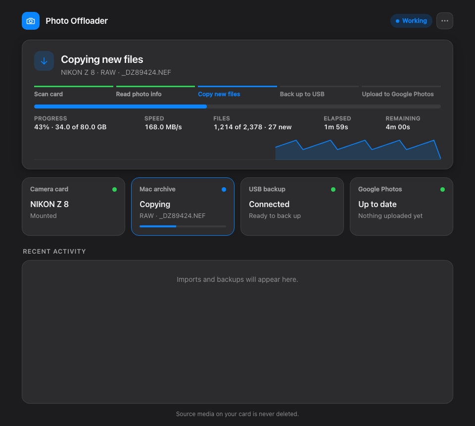

# Photo Offloader

Insert a camera card into your Mac and Photo Offloader does the rest. It copies everything to
the Mac and checks each copy with SHA-256, mirrors the archive to a USB drive, and can upload
JPGs and video to Google Photos. It never deletes anything from the card and never overwrites
an existing file.

```text
Camera card  →  Mac (verified)  →  USB drive (optional)  →  Google Photos (optional, no RAW)
```



## Requirements

- macOS (the only supported system for now) with Python 3.9 or newer
- Optional: a USB drive for the backup, named `Photos` unless you [choose another name](docs/configuration.md#settings-in-the-code)
- Optional: [ExifTool](https://exiftool.org) (`brew install exiftool`), so videos are filed under their camera
- Optional: [rclone](https://rclone.org) and a Google Cloud sign-in for Google Photos: see the [setup guide](docs/google-photos.md)

## Install, upgrade, uninstall

From a clone of this repository:

```bash
./install.sh                   # install, or upgrade after a git pull
./uninstall.sh --dry-run       # preview what uninstalling removes
./uninstall.sh                 # uninstall; your photos and catalog stay
```

The dashboard opens when the install finishes, and a 📷 appears in the menu bar. Insert a card
to start.

Treat this as backup infrastructure, not your only copy. After installing or upgrading, check
the files in the archive before you format a card.

## Where things are

The archive folders and the USB drive are defaults that you can
[change](docs/configuration.md#settings-in-the-code).

| What | Where |
| --- | --- |
| Photos, video and other files | `~/Pictures/CameraImports` |
| RAW files | `~/Pictures/CameraImportsRaw` |
| USB backup | `/Volumes/Photos/CameraImports` |
| Import log | `~/.camera_transfer.log` (or **⋯ › View logs** in the dashboard) |
| Start, stop, status | `~/Library/Application Support/PhotoOffloader/scripts/service.sh` |

## Documentation

These pages are also on the [project website](https://devturner.github.io/photo_offloader/).

- [Using Photo Offloader](docs/using.md): the dashboard and menu bar, what each step means, pausing and stopping
- [Google Photos setup](docs/google-photos.md): a step-by-step guide, with a command that checks your setup
- [How it works](docs/how-it-works.md): the safety model, archive layout, catalog and logs
- [Configuration](docs/configuration.md): settings and environment variables
- [Development](docs/development.md): repository layout, tests and project rules
- [Contributing](CONTRIBUTING.md): reporting a bug and proposing a change
- [Changelog](CHANGELOG.md)

## License

[MIT](LICENSE)
